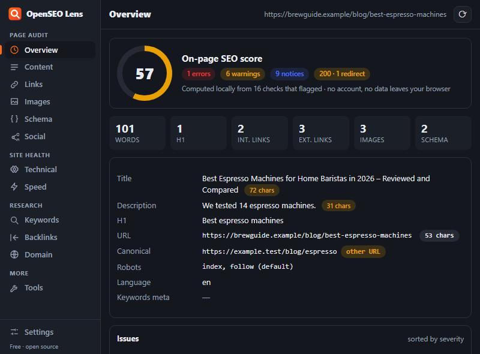
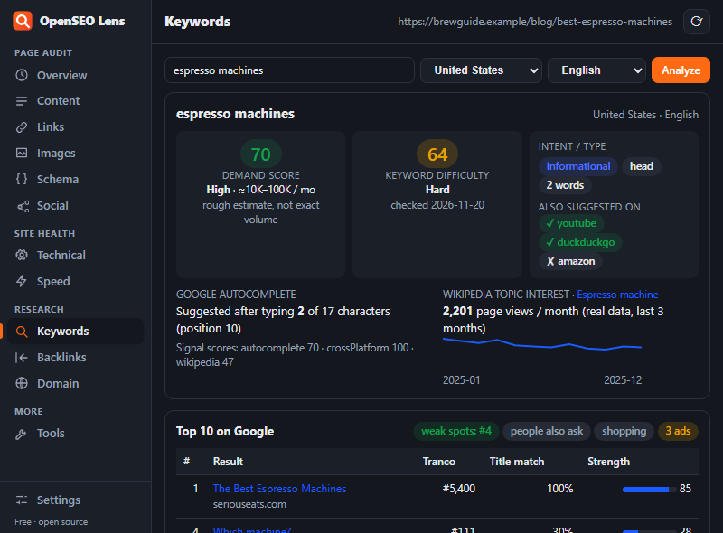
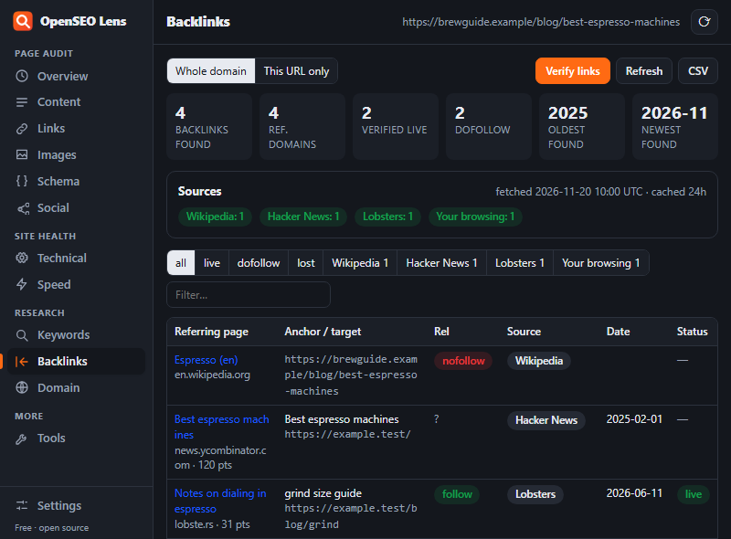
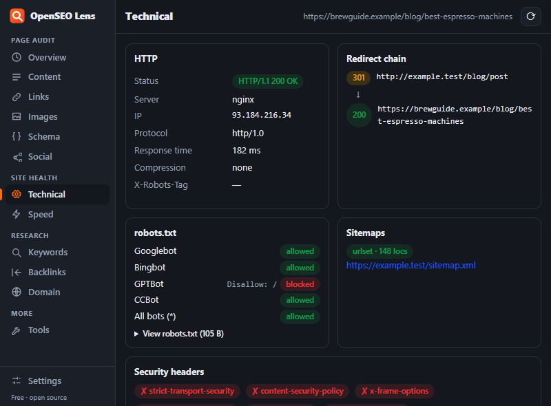

<p align="center">
  
</p>

<h1 align="center">OpenSEO Lens</h1>

<p align="center">
  <b>The free, open-source SEO toolbar for your browser.</b><br>
  Audit any page, research keywords, find backlinks and size up the competition<br>
  <b>without an account, a login or an API key.</b>
</p>

<p align="center">
  <a href="LICENSE"></a>
  
  
  
  
</p>

<p align="center">
  <a href="#-install-in-30-seconds"><b>Install</b></a> ·
  <a href="#-everything-you-get"><b>Features</b></a> ·
  <a href="#-how-it-compares"><b>Compare</b></a> ·
  <a href="#-faq"><b>FAQ</b></a> ·
  <a href="#-contributing"><b>Contribute</b></a>
</p>

<p align="center">
  
</p>

---

## ⚡ Why OpenSEO Lens

Most SEO toolbars want a monthly subscription, an account, or an API key before they show you anything useful. OpenSEO Lens doesn't.

- **💸 Free forever.** No trial, no paywall and no "upgrade to see this number". MIT-licensed.
- **🔓 No sign-in, no keys.** Install it, click the icon and you have the data. Every data source is public.
- **🛡️ Private by design.** Page analysis runs inside your browser. Your pages, searches and browsing are never uploaded to us, because there is no "us" server.
- **🧠 Honest numbers.** Where free data is an estimate, the extension says so. Where it's real (pageviews, redirects, Core Web Vitals), it shows the real thing.
- **🪶 Tiny and transparent.** About 170 KB of plain JavaScript (around 70 KB zipped) with no build step and no trackers. Read every line yourself.

---

## 🧰 Everything you get

**12 tools in one sidebar**, plus an overlay right inside Google, Bing and DuckDuckGo.

<table>
  <tr>
    <td width="50%"></td>
    <td width="50%"></td>
  </tr>
  <tr>
    <td align="center"><b>Keyword research:</b> demand, difficulty, intent and ideas</td>
    <td align="center"><b>Backlinks:</b> found, verified and exportable</td>
  </tr>
</table>

### 🔍 Keyword research
- **Keyword difficulty (0–100)** worked out from the real Google top 10: how strong each ranking site is, how well its title matches, and the **weak spots** (forum posts or off-topic pages) you can outrank.
- **Demand score** with a rough monthly search range, built from Google autocomplete, **real Wikipedia pageviews** with a 12-month trend, and YouTube, Amazon and DuckDuckGo suggestions.
- **Search intent** (informational, commercial, transactional, local or navigational) and head vs long-tail.
- **Hundreds of keyword ideas** with a **Questions** filter, each one scored. Pick from 16 countries and 10 languages. Export to CSV.

### 🔗 Backlinks
- Backlinks and referring domains from **Wikipedia (12 languages), Hacker News, Lobsters and Stack Overflow**.
- A **personal link graph** that grows as you browse and remembers which sites link to which. It's stored only on your machine.
- **One-click verification.** Each referring page is opened to confirm the link still exists, and its anchor text and **dofollow/nofollow** are recorded.
- Top referring domains, anchor-text cloud, whole-domain vs single-URL view, and CSV export.

### 📝 On-page audit
- A **0–100 SEO score** from about 45 checks, with every issue ranked as an error, warning or notice and explained.
- Title, meta description, canonical, robots, H1 and language at a glance, with length warnings.
- **Content:** word count, reading time, readability, text-to-HTML ratio, the heading tree (skipped levels flagged), and 1-, 2- and 3-word keyword density.
- **Links:** internal vs external, nofollow/sponsored/ugc, a **broken-link checker**, and colour-coded highlighting on the page.
- **Images:** missing alt text, missing dimensions, heavy files, oversized images and old image formats.
- **Schema:** every JSON-LD block (broken JSON flagged), microdata and RDFa, with one-click Rich Results validation.
- **Social:** pixel-accurate **Google result preview**, plus Facebook, LinkedIn and X card previews.

<p align="center">
  
</p>

### 🛠️ Technical & speed
- **HTTP status and the full redirect chain**, captured while the page loads. The toolbar badge turns green, amber or red at a glance.
- Response and **security headers**, and a **robots.txt tester** for Googlebot, Bingbot, **GPTBot**, CCBot and `*`.
- Sitemap discovery, hreflang checks, mixed content, resource weight, render-blocking scripts and **tech-stack detection** (WordPress, Shopify, Next.js, GA4, GTM and more).
- **Real Core Web Vitals** from your own visit (LCP, CLS, INP, FCP, TTFB), plus a one-click **Lighthouse** test.

### 🌐 Domain intel
- **Tranco popularity rank**, **domain age**, registrar and expiry (RDAP), **Wayback Machine** first-seen date and DNS records.

### 🔎 Inside the search results
- A slim bar under every Google, Bing and DuckDuckGo result shows its position, domain, title length, URL depth and popularity rank.
- On Google, a **difficulty panel** above the results shows KD, demand, intent, SERP features (AI Overview, People also ask, shopping, ads) and the weak spots in the top 10.

### 📤 Export everything
- Full report as **JSON**, issues as **CSV**, and a **Markdown** summary ready to paste into a client email or ticket.

---

## 📊 How it compares

|  | Typical paid SEO toolbar | **OpenSEO Lens** |
|---|---|---|
| Price | Monthly subscription | **Free forever** |
| Account / login | Required | **Not needed** |
| API keys | Often required | **None** |
| Open source | No | **Yes (MIT)** |
| Your browsing sent to a vendor | Often | **Never** |
| On-page audit, schema, social, technical | ✅ | ✅ |
| Redirect chain and HTTP headers | ✅ | ✅ |
| Real Core Web Vitals from your visit | Sometimes | ✅ |
| Keyword difficulty | ✅ from a private index | ✅ from the live Google top 10 |
| Search volume | Modelled exact numbers | Demand score plus a rough range |
| Backlink index | Huge proprietary web crawl | Public sources plus your own browsing |

**Where paid tools are still ahead:** they run crawlers that cover the whole web, so their backlink counts and search volumes reach far more sites, especially small ones. OpenSEO Lens covers everything a page can tell you, and gets the rest from free public sources. It won't pretend an estimate is an exact count.

---

## 🚀 Install in 30 seconds

1. **Download** this repository: click the green **Code** button, choose **Download ZIP**, then unzip it.
2. Open `chrome://extensions` (or `edge://extensions` / `brave://extensions`).
3. Turn on **Developer mode** (top-right corner).
4. Click **Load unpacked** and pick the unzipped `openseo-lens` folder.
5. Pin the 🔍 icon, open any website and click it. Shortcut: **`Alt+Shift+S`**.

> 💡 Reload tabs that were already open before you installed, so the extension can capture their HTTP status and redirects.

**Shortcuts:** `Alt+Shift+S` opens the toolbar and `Alt+Shift+H` highlights links on the page. You can change them at `chrome://extensions/shortcuts`.

---

## 👥 Built for

- **Bloggers & content writers:** pick keywords you can actually rank for, then check the page before publishing.
- **Agencies & freelancers:** run instant audits on client and prospect sites, then export a Markdown summary for the pitch.
- **Developers:** check redirects, headers, robots.txt, schema and Core Web Vitals without leaving the tab.
- **Store owners:** find missing alt text, slow images and broken links that cost you sales.
- **Students & learners:** see how SEO works from readable code and clear explanations, for free.

---

## ❓ FAQ

<details>
<summary><b>Is it really free? What's the catch?</b></summary>

There isn't one. OpenSEO Lens is MIT-licensed open source and has no server of its own, so there's nothing to charge for. It uses only public, keyless data sources.
</details>

<details>
<summary><b>How accurate is the search volume?</b></summary>

Exact Google search volumes are only available inside Google Ads (which needs a login) or in paid databases. OpenSEO Lens gives a **demand score** from public signals, plus a rough range: `<100`, `100–1K`, `1K–10K`, `10K–100K` or `100K+`. It's reliable for **comparing and ranking** keywords against each other. The Wikipedia pageview numbers are real data, for the topic rather than the exact query.
</details>

<details>
<summary><b>How is keyword difficulty calculated?</b></summary>

From the current Google top 10. It looks at each ranking site's popularity (Tranco rank), how closely its title matches the query, whether it's a homepage, and whether it's a forum or user-generated page (an easier target). The top 3 positions are weighted higher. It reads **your own normal Google search**: the results page you're on, or one search opened in a background tab when you click *Check difficulty*. It never mass-queries Google. If Google asks you to confirm you're human, the tab is left open for you to solve.
</details>

<details>
<summary><b>Why does a small site show few backlinks?</b></summary>

Free public sources (Wikipedia, Hacker News, Lobsters, Stack Overflow) cover well-known sites best. Your **personal link graph** fills in more as you browse. For a complete list for a site **you own**, connect it to Google Search Console or Bing Webmaster Tools. Both are free.
</details>

<details>
<summary><b>What data leaves my browser?</b></summary>

Page content never does. The extension calls these public endpoints, and only when you open the related section or press a button:
`tranco-list.eu`, `rdap.org`, `wikipedia.org`, `wikimedia.org`, `suggestqueries.google.com`, `duckduckgo.com/ac`, `completion.amazon.com`, `hn.algolia.com`, `lobste.rs`, `api.stackexchange.com`, `web.archive.org`, `cloudflare-dns.com` and `googleapis.com/pagespeedonline` (Lighthouse button).
The broken-link checker requests the page's own links, and **Verify links** requests the referring pages.

The **local link graph** records which external sites the pages you visit link to (URL, anchor text, rel). It skips search engines, local addresses and pages with a password field, and stays in `chrome.storage.local`. You can switch it off or delete it in Settings.
</details>

<details>
<summary><b>Which browsers are supported?</b></summary>

Any Chromium browser with Manifest V3: Google Chrome, Microsoft Edge, Brave, Opera, Vivaldi and Arc.
</details>

---

## 🤝 Contributing

Contributions are very welcome: bug reports, new audit checks, new free data sources, translations and UI polish.

1. Fork the repo and create a branch.
2. Make your change. It's plain JavaScript with **no build step**: edit a file, then click reload on `chrome://extensions`.
3. To work on the popup UI without reloading the extension, run `python -m http.server 8765` in this folder and open `http://127.0.0.1:8765/test/harness.html`. It renders the real popup against a test page with a fake `chrome` object.
4. Open a pull request describing what you changed and why.

Please keep the core promise intact: **no accounts, no API keys, and no page data sent to third parties.**

<details>
<summary><b>Project layout</b></summary>

```
manifest.json          MV3 manifest
background.js          service worker: redirect/header capture, badge, keyless data sources,
                       link checker, backlinks, keyword demand and difficulty
content/vitals.js      Core Web Vitals observers (document_start on every page)
content/linkgraph.js   local link graph recorder (outbound links → Backlinks)
content/analyzer.js    on-page extractor, injected on demand by the popup
content/highlight.js   link highlighter overlay
content/serp.js/.css   search-results overlay and keyword-difficulty panel
lib/audit.js           audit rules + score
lib/robots.js          RFC 9309 robots.txt parser/matcher
popup/                 the sidebar toolbar UI
options/               settings
test/                  dev harness + fixture page (?shot=<section> renders README screenshots)
docs/                  screenshots
```
</details>

---

## 📄 License

[MIT](LICENSE). Use it, fork it, ship it.

## 👤 Author

Created and maintained by **Prafful Sharma** ([@hashencoder](https://github.com/hashencoder)).

<p align="center">
  If OpenSEO Lens saves you a subscription, <b>⭐ star the repo</b> so others can find it.
</p>
